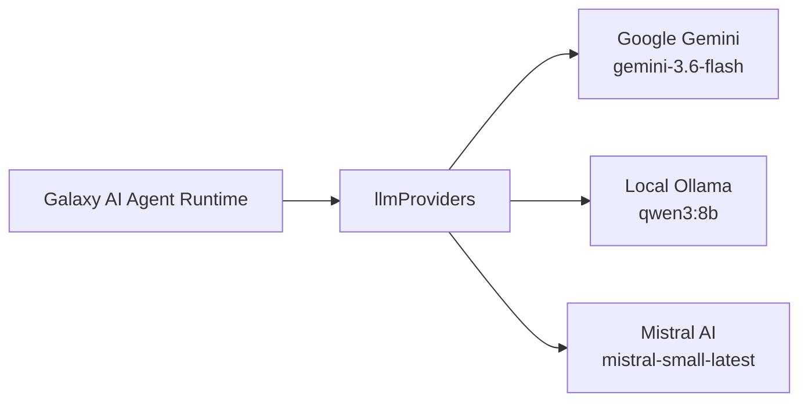

# Agent Architecture & LLM Providers

> **Galaxy AI Documentation Hub**: [🏠 Root README / Master Index](../README.md) • [📂 Docs Directory](./)

This document explains the internal mechanics of the Galaxy AI agent runtime, prompt orchestration, provider integration, and memory persistence.

---

## 1. Agent Engine & ReAct Loop

Galaxy AI uses LangChain's `create_agent` framework located in `source/agent/createNewAgent.py`:

```python
def createNewAgent(llmProviderModel):
    agent = create_agent(
        model = llmProviderModel,
        system_prompt = systemPrompt.prompt,
        tools = AGENT_TOOLS
    )
    return agent
```

### Execution Lifecycle

1. **Prompt Ingestion**: A user message arrives via the terminal input or the WebSocket endpoint.
2. **Context Assembly**: Historic messages are loaded from `memory.db` and converted into LangChain message primitives (`HumanMessage`, `AIMessageChunk`).
3. **Inference & Reasoning**: The agent invokes `agent.astream({"messages": messages}, stream_mode="messages")`.
4. **Tool Dispatching**: When the model decides to call any of the **20 registered tools**:
   - LangChain generates a `ToolMessage` with the tool name and arguments.
   - If the tool requires permission (`commands_executor`), the `PermissionManager` pauses the stream and requests user approval.
   - The tool executes and its return payload is fed back into the reasoning loop.
5. **Response Streaming & Persistence**: Tokens are emitted chunk by chunk to the user interface, and the full final response is committed back to the SQLite memory store.

---

## 2. Multi-Provider LLM System

Galaxy AI implements provider abstraction in `source/provider/llmProviders.py`.



### Supported Providers & Models

| Provider | Library Class | Default Model | Configuration Required |
|---|---|---|---|
| **Google Gemini** | `ChatGoogleGenerativeAI` | `gemini-3.6-flash` | `GOOGLE_API_KEY` in `.env` |
| **Ollama** | `ChatOllama` | `qwen3:8b` | Local Ollama daemon running on default port (`11434`) |
| **Mistral AI** | `ChatMistralAI` | `mistral-small-latest` | `MISTRAL_API_KEY` in `.env` |

### Dynamic Provider Switching at Runtime

The active model is stored in `source/agent/agent.py`:
- Calling `PATCH /change-agent-provider` or using terminal command `/providers` constructs a new provider instance via `providerFunctions[newProvider]()`.
- `setNewAgentProvider()` updates the global reference instantly without requiring server restart.

### Temperature Tuning

- **Default Temperature**: Configured in `source/provider/llmTemperatures.py`.
- **Runtime Modification**: Calling `PATCH /change-agent-temperature` updates the model's sampling temperature in place.

---

## 3. Dual Memory System

1. **Continuous Memory (`memory.db`)**:
   - Managed by `source/memory/agentMemory.py`.
   - Used primarily by the interactive CLI agent. Automatically loads prior conversation context on startup so you can resume where you left off.
2. **Session Memory (`chats.db`)**:
   - Managed by `source/memory/chatHistoryMemory.py`.
   - Used by the REST and WebSocket endpoints for multi-tab conversation threads with titles, message timestamps, and cascading deletion.

---

## 🔗 Cross-Document Reference
- [Architecture Guide](architecture.md) — System-wide component structure
- [Tools Reference](tools.md) — Detailed catalog of all 20 agent tools
- [API Reference](api.md) — Endpoints for model and provider switching
- [Configuration Guide](configuration.md) — API keys and database parameters
