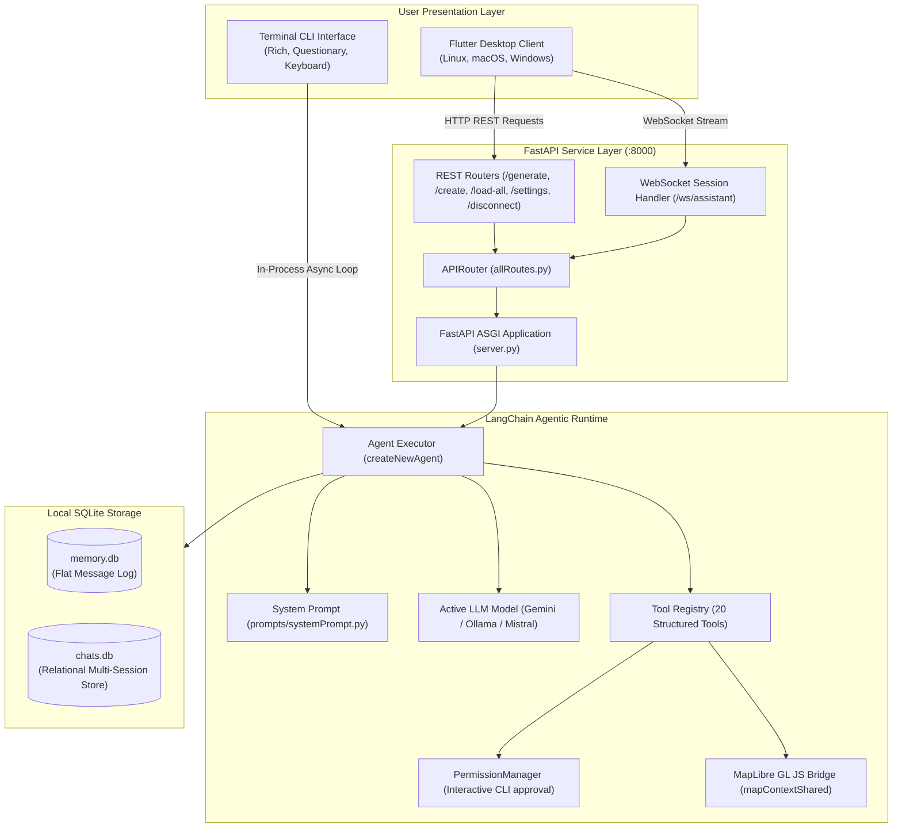
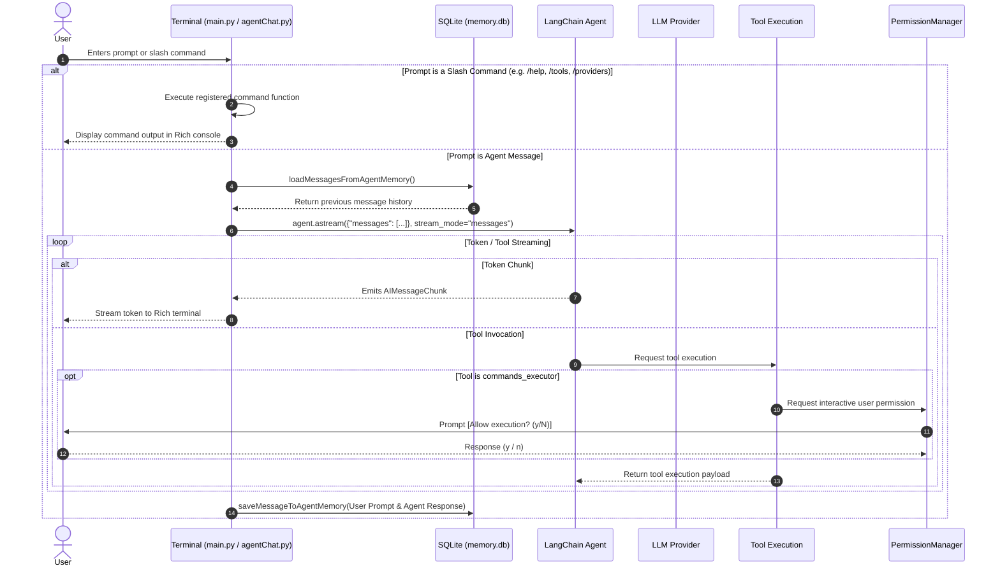
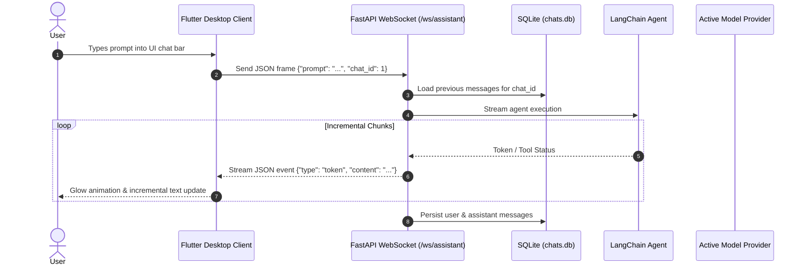

# Galaxy AI Agent Architecture

> **Galaxy AI Documentation Hub**: [🏠 Root README / Master Index](../README.md) • [📂 Docs Directory](./)

This document provides a comprehensive technical overview of the software architecture of Galaxy AI Agent, including process models, communication boundaries, agent runtime loops, and state management.

---

## 1. System Topology

Galaxy AI Agent is designed as a hybrid client-server desktop system composed of three primary operational tiers:



---

## 2. Process Architecture

When launched via `startGalaxy` (binary or `python startGalaxy.py`), two primary processes are instantiated depending on the provided arguments:

1. **Uvicorn Server Daemon Process**:
   - Spawned as a background subprocess via `subprocess.Popen([sys.executable, "-m", "uvicorn", "server:agentServer", "--host", "127.0.0.1", "--port", ...])`.
   - On Windows, uses `creationflags = subprocess.CREATE_NO_WINDOW` to avoid visual clutter.
   - Redirects stdout and stderr to rotating daily log files in `source/logs/` (e.g. `Server_YYYY-MM-DD.log`).
   - Stores the active process ID in `source/logs/server.pid` for graceful shutdown and process lifecycle management.

2. **Interactive Terminal Agent Process**:
   - Launched in the terminal via `startNewTerminal([sys.executable, "main.py"], "Galaxy AI - Agent")`.
   - Spawns background worker threads:
     - `startKeyboardMappingThread()`: Listens for system-wide hotkeys using the `keyboard` library.
     - `AgentChatModeThread`: Runs the `asyncio` event loop driving the interactive chat prompt, Rich streaming output, and CLI slash-command executor.

3. **Flutter Desktop Process (Optional)**:
   - An independent native GUI process communicating over local loopback (`http://127.0.0.1:8000` and `ws://127.0.0.1:8000/ws/assistant`).

---

## 3. End-to-End Request & Data Flows

### A. Terminal CLI Chat Flow



### B. Flutter GUI WebSocket Flow



---

## 4. SQLite Database Schemas

Galaxy AI Agent utilizes dual local SQLite databases to balance unpartitioned CLI memory with structured multi-session chat history.

### Database 1: `memory.db` (Flat Agent Memory)
Located at: `.galaxy/server/databases/memory/memory.db`

```sql
CREATE TABLE messages (
    id INTEGER PRIMARY KEY AUTOINCREMENT,
    role TEXT NOT NULL,
    content TEXT NOT NULL,
    created_at TIMESTAMP DEFAULT CURRENT_TIMESTAMP
);
```

### Database 2: `chats.db` (Multi-Session Structured Store)
Located at: `.galaxy/server/databases/memory/chats.db`

```sql
CREATE TABLE IF NOT EXISTS chats (
    id INTEGER PRIMARY KEY AUTOINCREMENT,
    title TEXT NOT NULL UNIQUE,
    created_at TIMESTAMP DEFAULT CURRENT_TIMESTAMP NOT NULL,
    updated_at TIMESTAMP DEFAULT CURRENT_TIMESTAMP NOT NULL
);

CREATE TABLE IF NOT EXISTS messages (
    id INTEGER PRIMARY KEY AUTOINCREMENT,
    chat_id INTEGER NOT NULL,
    role TEXT NOT NULL,
    content TEXT NOT NULL,
    created_at TIMESTAMP DEFAULT CURRENT_TIMESTAMP NOT NULL,
    FOREIGN KEY (chat_id) REFERENCES chats(id) ON DELETE CASCADE
);

CREATE INDEX IF NOT EXISTS idx_messages_chat_id ON messages(chat_id);
```

---

## 5. Process Shutdown Architecture

1. **CLI Termination**: Typing `/exit` or `quit-agent` safely closes open SQLite cursors and stops background listener threads.
2. **Server Termination**:
   - Calling `GET /disconnect` reads `server.pid` from `source/logs/server.pid` and terminates the Uvicorn process.
   - Slash command `/terminate-server` terminates the background server directly from the terminal.

---

## 🔗 Cross-Document Reference
- [Configuration Guide](configuration.md) — Database file paths and logging conventions
- [API Reference](api.md) — REST endpoints and WebSocket protocol
- [Tools Reference](tools.md) — All 20 native tools and security permissions
- [CLI Reference](cli.md) — Command-line interface and keyboard shortcuts
