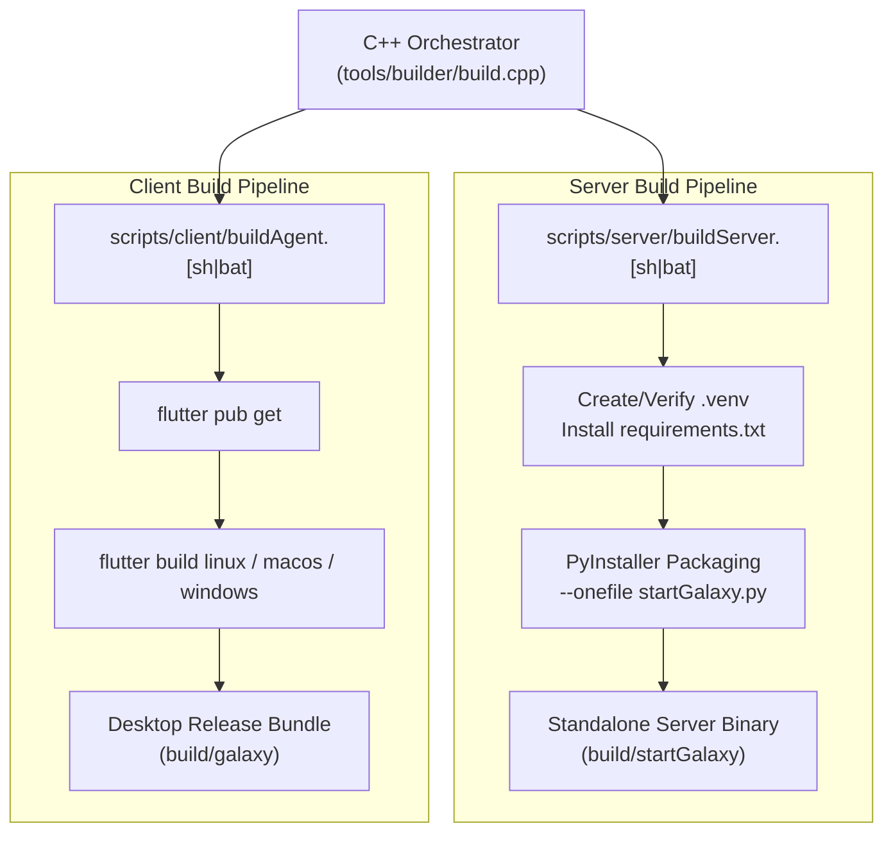

# Build System & Release Packaging

> **Galaxy AI Documentation Hub**: [🏠 Root README / Master Index](../README.md) • [📂 Docs Directory](./)

Galaxy AI Agent includes a dual packaging workflow orchestrated either through a unified C++ build runner or individual platform scripts.

---

## 1. Build Architecture



---

## 2. The Unified C++ Builder (`tools/builder`)

The builder orchestrator is located at `tools/builder/`:
- **`build.cpp`**: Main entry point invoking `ExecuteScript`.
- **`buildConfigurations.h`**: Defines flags (`--server`, `--agent`) and script paths.
- **`executeScript.h`**: Detects OS at compile and runtime (`_WIN32`, `__APPLE__`, `__linux__`), appends `.bat` or `.sh`, and executes the commands.

### Compiling and Running the Builder

```bash
cd tools/builder
g++ -std=c++17 build.cpp -o build
./build
```

On Windows (using MinGW or MSVC):
```cmd
cd tools\builder
g++ -std=c++17 build.cpp -o build.exe
build.exe
```

### Build Flags

| Command / Flag | Action |
|---|---|
| `./build` (no flags) | Compiles **both** the backend server and the Flutter desktop client. |
| `./build --server` | Compiles **only** the FastAPI server and terminal agent binary. |
| `./build --agent` | Compiles **only** the Flutter desktop client release package. |
| `./build -h` or `--help` | Displays builder options and usage menu. |

---

## 3. Server Packaging (`buildServer.sh` / `buildServer.bat`)

Located at `scripts/server/`:

1. **Environment Verification**:
   - Checks for `python3` (or `python.exe`) and verifies version $\ge 3.10$.
   - On Linux systems with missing Python, attempts automatic installation via apt, dnf, or pacman.
2. **Virtual Environment**:
   - Provisions `.galaxy/server/.venv` if not already present.
   - Upgrades `pip` and installs all packages from `.galaxy/server/requirements.txt`.
3. **Nuitka Execution**:
   - Packages `.galaxy/server/startGalaxy.py` into a single standalone binary.
   - Bundles icons from `scripts/icons/`.
   - Moves the compiled binary into the project root `build/` directory (`build/startGalaxy` or `build/startGalaxy.exe`).

---

## 4. Client Packaging (`buildAgent.sh` / `buildAgent.bat`)

Located at `scripts/client/`:

1. **Flutter SDK Detection**:
   - Verifies `flutter` is on PATH.
   - Checks desktop platform support (`linux`, `macos`, or `windows`).
2. **Dependency Resolution**:
   - Runs `flutter pub get` in `.galaxy/client/`.
3. **Release Build**:
   - Runs `flutter build <platform> --release`.
   - Copies the compiled executable and bundle data into `build/`.

---

## 5. Running the Project Output

Execute the built applications directly from `build/`:

**Linux / macOS:**
```bash
# 1. Run the backend server & interactive terminal CLI:
./build/startGalaxy

# 2. Or launch the native Flutter desktop client:
./build/galaxy
```

**Windows:**
```cmd
:: 1. Run the backend server & interactive terminal CLI:
build\startGalaxy.exe

:: 2. Or launch the native Flutter desktop client:
build\galaxy.exe
```

---

## 🔗 Cross-Document Reference
- [Installation Guide](installation.md) — System requirements and compiler setup
- [CLI Reference](cli.md) — Runtime arguments for `startGalaxy`
- [Troubleshooting](troubleshooting.md) — Compiler or Nuitka errors
