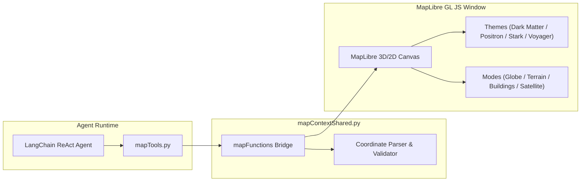

# Interactive Map Tools & Geospatial System

> **Galaxy AI Documentation Hub**: [🏠 Root README / Master Index](../README.md) • [📂 Docs Directory](./) • [🛠 Tools Reference](tools.md)

Galaxy AI Agent integrates a native, interactive geospatial map interface powered by **MapLibre GL JS** (`source/tools/mapTools.py` and `source/gui/map/`). The agent can open the map, navigate the camera to any coordinates, drop custom pins, and compute spherical distances between coordinate points.

---

## 1. Map Architecture

The map subsystem is built on a shared context pattern (`source/gui/map/mapContextShared.py`) communicating with an embedded Chromium/WebEngine or web-view window:



---

## 2. Visualization Modes & Themes

The map interface supports six real-time rendering modes and four appearance styles:

### Visualization Modes
1. **Globe Mode**: Full 3D planetary globe projection with atmospheric glow.
2. **Street Mode**: Standard street-level navigation map with roads and labels.
3. **Satellite Mode**: High-resolution orbital satellite photography.
4. **Hybrid Mode**: Satellite imagery overlaid with street names and boundaries.
5. **Terrain Mode**: 3D elevation contour mapping for topography exploration.
6. **3D Buildings Mode**: Volumetric extruded 3D architectural representations.

### Appearance Themes
- **Stark Blue**: High-contrast blue accent theme for technical diagnostics.
- **Dark Matter**: Low-light dark theme optimized for night operations.
- **Positron Light**: Minimalist daylight theme with clean gray/white palette.
- **Voyager**: Vibrant exploration theme highlighting natural landscape features.

---

## 3. Tool Signatures & Usage

### 1. `open_map`
- **Identifier**: `open_map`
- **Implementation**: `source/tools/features/openMap.py`
- **When to Use**: When the user requests to view, open, or inspect the interactive map. If the map window is already running, the agent skips redundant calls.
- **Example User Prompts**:
  - *"Show me the map"*
  - *"Open the interactive 3D globe"*

### 2. `fly_to_location_on_map`
- **Identifier**: `fly_to_location_on_map`
- **Implementation**: `source/tools/mapTools.py` (`FlyToLocationModel`)
- **Parameters**:
  - `latitude` (float): Decimal degrees between -90.0 and 90.0.
  - `longitude` (float): Decimal degrees between -180.0 and 180.0.
  - `zoom` (float): Camera zoom magnification level (1.0 = global view, 15.0 = street level).
- **Example Usage**:
  ```python
  fly_to_location_on_map(latitude=37.7749, longitude=-122.4194, zoom=12.0)
  ```

### 3. `add_marker_on_coordinate_on_map`
- **Identifier**: `add_marker_on_coordinate_on_map`
- **Implementation**: `source/tools/mapTools.py` (`AddCoordinateMarkerModel`)
- **Parameters**:
  - `latitude` (float): Target latitude coordinate.
  - `longitude` (float): Target longitude coordinate.
- **Features**: Supports multiple visual markers simultaneously on the same map canvas. Adding a marker does not alter camera position or zoom level.

### 4. `calculate_coordinate_distance_on_map`
- **Identifier**: `calculate_coordinate_distance_on_map`
- **Implementation**: `source/tools/mapTools.py` (`CalculateCoordinateDistanceModel`)
- **Parameters**:
  - `latitude_a` (float): Latitude of starting point.
  - `longitude_a` (float): Longitude of starting point.
  - `latitude_b` (float): Latitude of destination point.
  - `longitude_b` (float): Longitude of destination point.
- **Mathematical Model**: Great-circle spherical distance using the Haversine formulation:
  $$d = 2r \arcsin\left(\sqrt{\sin^2\left(\frac{\Delta \phi}{2}\right) + \cos(\phi_1)\cos(\phi_2)\sin^2\left(\frac{\Delta \lambda}{2}\right)}\right)$$
  Where $r = 6371\text{ km}$.
- **Return Value**: Distance string formatted in kilometers (`km`).

---

## 4. Troubleshooting Map Operations

- **Map window does not appear**: Ensure graphical display server (`X11`, `Wayland`, or Windows desktop) is active. In headless server environments, map launching is ignored gracefully.
- **Invalid coordinates error**: Coordinates must be in decimal degrees (e.g. `40.7128`, not `40° 42' 46" N`).
